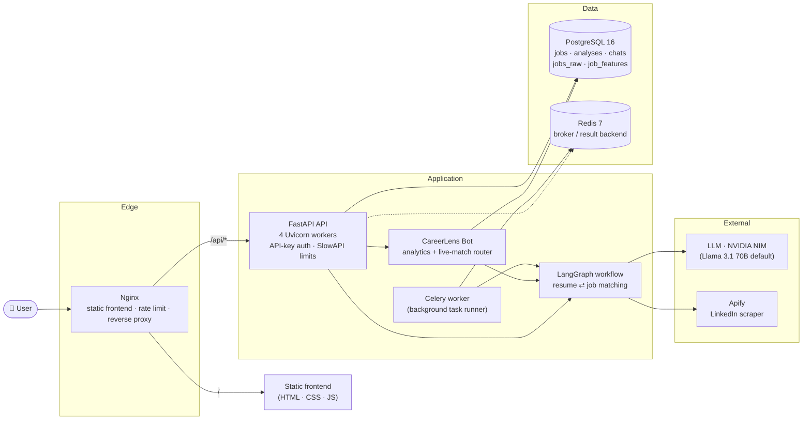
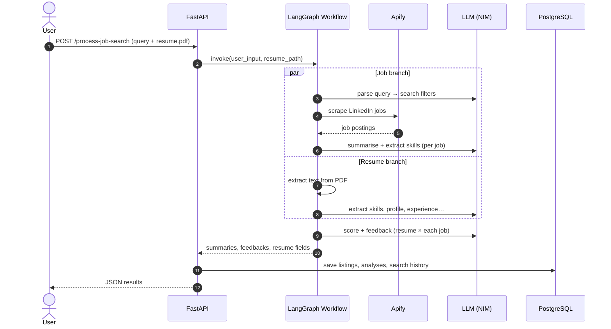
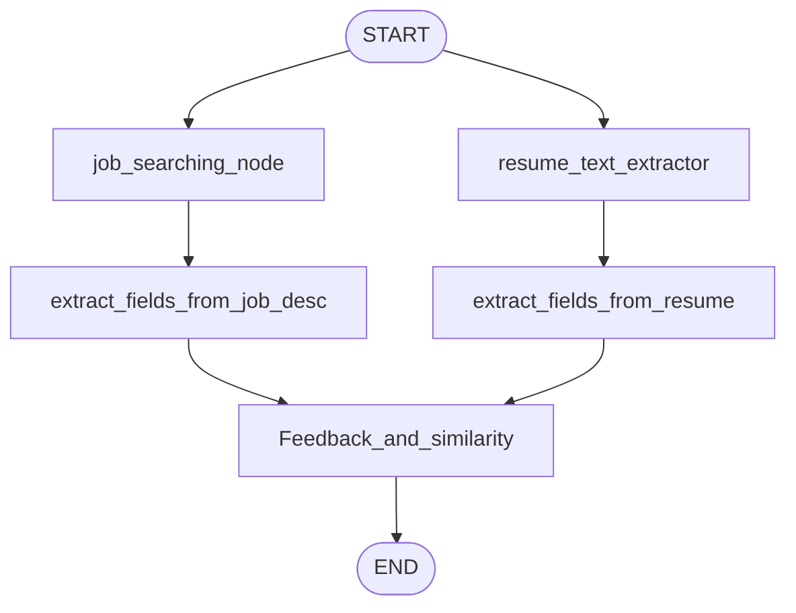
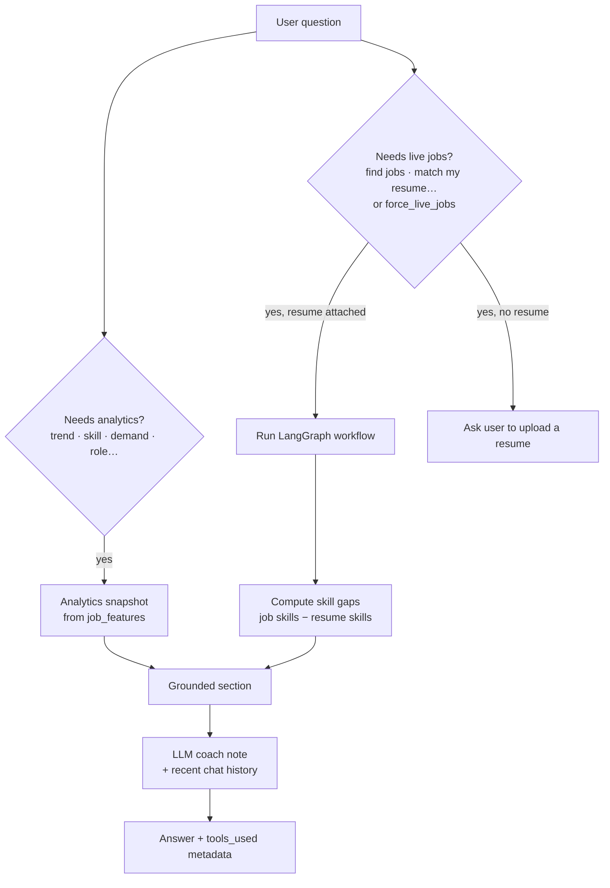
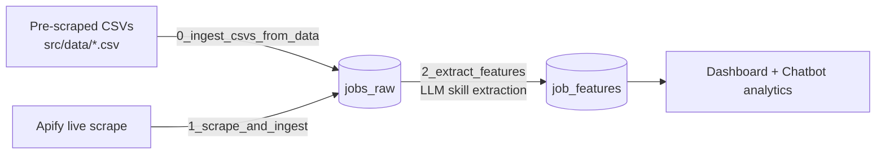

<div align="center">

# 🔍 CareerLens

### An AI job-search agent, market-intelligence dashboard, and career mentor — in one app.

*Stop guessing whether you fit a job. Match your resume against live openings, see what the market actually demands, and get a coach that answers from real data.*


[Objective](#-objective) · [Overview](#-overview) · [Architecture](#-architecture) · [Deep Dive](#-deep-dive) · [Quick Start](#-quick-start) · [API](#-api-reference) · [Structure](#-project-structure)

</div>

---

## 🎯 Objective

Job hunting is noisy. Job boards show *listings*, not *fit*, and career advice online is generic. CareerLens exists to answer three questions with evidence instead of guesswork:

| Question | How CareerLens answers it |
|---|---|
| **"Am I a good fit for this job?"** | An agent workflow reads your resume and each live posting, scores the match from 0–100, and tells you which skills you're missing. |
| **"What does the market want right now?"** | An analytics dashboard aggregates scraped postings into skill demand, role activity, hiring locations, and posting trends. |
| **"What should I learn next?"** | A chatbot mentor combines the market data with your resume's skill gaps to produce a concrete upskilling plan. |

The goal is to close the loop between **your profile → the market → your next step**, using LLMs for what they are good at (turning messy text into structured data) and plain code for everything that needs to be deterministic (counting, ranking, gap analysis).

---

## ✨ Overview

CareerLens has three modules that share one backend and one database.

### 1. 🧲 Job Search & Resume Matching
Describe the job you want in plain English ("*3 data science jobs in India, entry level*") and upload a PDF resume.

- Your sentence is parsed into structured search filters (title, location, recency, experience level, work type).
- Live LinkedIn postings are scraped through Apify.
- The resume and every job description are converted to structured data **in parallel**.
- Each job gets a **similarity score (0–100)** and **specific feedback** on missing skills, keywords, and projects.
- Every run is saved, so past jobs and searches can be revisited without re-running the analysis.

### 2. 📊 Job Market Analytics
A dashboard computed from the PostgreSQL job-feature store:

- Total jobs, unique companies, locations, and skills
- Top in-demand skills
- Most active roles, plus an engineering-only breakdown
- Top hiring locations and companies, and which roles dominate each location
- Posting-date timeline to spot hiring waves

### 3. 🤖 CareerLens Mentor (Chatbot)
A career coach that is **grounded in tool output**, not just LLM opinion.

- Asks about trends or skills? It reads the analytics snapshot first.
- Asks to find jobs or match your resume? It runs the full matching workflow live.
- Asks "*How do I switch from Data Analyst to Data Scientist?*" It diffs the top skills of both roles from real postings and lists the likely gaps.
- Conversations are persisted as sessions, so you can come back to them.

---

## 🏗️ Architecture

### System view



### Request flow



### Design principles

- **LLMs extract; code decides.** Models turn unstructured text into validated Pydantic objects. Counting skills, ranking roles, and computing skill gaps are plain Python, so those numbers are reproducible and can't be hallucinated.
- **Parallel by construction.** The resume and the job postings don't depend on each other until scoring, so the graph processes them concurrently.
- **Grounded chat.** Every chatbot answer starts with a tool-derived section and *then* adds a "Coach note" from the LLM. If the LLM call fails, the user still gets the grounded part.
- **Production-shaped from day one.** Multi-stage non-root Docker image, healthchecks on every service, connection pooling, rate limiting at two layers, and Alembic migrations.

---

## 🔬 Deep Dive

### The LangGraph matching workflow

The core of the app is a compiled `StateGraph` in [`src/graph.py`](src/graph.py). Two branches start from `START` and fan in to a single scoring node; LangGraph waits for both before running it.



| Node | What it does |
|---|---|
| `job_searching_node` | An LLM chain converts the user's sentence into a `JobInfo` object (title, country, recency, experience level, work type, limit), then calls the Apify scraper. The limit is capped at **3 jobs** per run to keep latency and cost predictable. |
| `extract_fields_from_job_desc` | For each new job, an LLM chain returns a short summary and the list of required skills. Already-seen job IDs are skipped. |
| `resume_text_extractor` | Reads the PDF with `pypdf`. |
| `extract_fields_from_resume` | An LLM chain returns `Resume_Fields`: skills, profile, projects, certifications, experience, education. |
| `Feedback_and_similarity` | Compares resume skills/profile against each job's skills/summary and returns a `0–100` score plus actionable feedback. |

**State** ([`src/state.py`](src/state.py)) is a `TypedDict`. The `job_summaries` and `job_feedbacks` fields use `Annotated[..., operator.add]` reducers so results accumulate across nodes instead of overwriting each other. `visited_ids` / `visited_ids_feedback` sets make the nodes idempotent.

**Structured output.** Every agent in [`src/agents.py`](src/agents.py) is a LangChain pipeline of `PromptTemplate → LLM → PydanticOutputParser`. The parser's format instructions are injected into the prompt and the response is validated against the Pydantic schema in [`src/structure_outputs.py`](src/structure_outputs.py), so downstream code never handles free-form text.

### The chatbot router

[`src/career_chatbot.py`](src/career_chatbot.py) is a small, explicit tool router rather than an open-ended agent loop:



- **Role canonicalisation.** Messy titles ("Sr. GenAI Developer") are mapped to ~10 canonical roles (AI Engineer, ML Engineer, Data Scientist, …) by keyword rules, so analytics group sensibly.
- **Transition analysis.** A regex pulls `from X to Y` out of the question; the bot then compares the top skills of role X with role Y from the real postings and reports the difference.
- **Skill-gap maths.** Gaps are the most frequent skills across the live jobs that are absent from the resume — a plain set difference, not an LLM guess.
- **Transparent responses.** The API returns `tools_used`, `analytics_used`, `live_jobs_used`, `live_jobs_count`, and `top_skill_gaps` so the UI can show exactly what the answer was based on.

### Two data stores in one PostgreSQL instance

| Purpose | Tables | Managed by |
|---|---|---|
| **App data** (what users did) | `joblisting`, `jobanalysis`, `searchhistory`, `chatsession`, `chatmessage` | SQLModel; created at API start-up |
| **Analytics store** (what the market looks like) | `jobs_raw` (exact scraper output as JSONB, deduplicated by Apify ID) → `job_features` (title, company, location, posting date, extracted `skills` as JSONB) | SQLAlchemy models in `src/Postres`; created by `create_table.py` |

Keeping the raw scrape as JSONB means features can be re-extracted later with a better prompt or model without re-scraping. An Alembic migration covers the app-data schema.

### The analytics ingestion pipeline

The dashboard is only as good as the data behind it. Three scripts in [`src/pipeline/`](src/pipeline) fill it:



Phase 2 only processes raw jobs that don't yet have features, retries each LLM call with a timeout, and falls back to generated placeholder skills if extraction keeps failing, so one bad job never stops a batch. Set `USE_SYNTHETIC_SKILLS_ONLY=true` to skip the LLM entirely for quick demos.

### Reliability & safety layers

| Layer | Mechanism |
|---|---|
| **Rate limiting** | Nginx: 10 req/s per IP, burst 30. App: SlowAPI — `5/min` on job search, `20/min` on chat. |
| **Auth** | Optional `X-API-Key` header on search and chat endpoints; keys come from `API_KEYS`. Auth is automatically off when no keys are configured (local dev). |
| **CORS** | Explicit origin allow-list from `ALLOWED_ORIGINS`, GET/POST only. |
| **Uploads** | PDF only, 10 MB cap at Nginx, written to a temp file and deleted in a `finally` block. |
| **Containers** | Multi-stage build, non-root user, healthchecks on Postgres, Redis, API, and Nginx; API waits for healthy dependencies. |
| **DB** | Connection pool (10 + 20 overflow), pre-ping, 30-min recycle; start-up table creation retries to survive multi-worker races. |
| **Security headers** | `X-Frame-Options`, `X-Content-Type-Options`, `Referrer-Policy` set by Nginx. |
| **Background tasks** | Celery is configured with JSON serialisation, late ack, 2 retries, and 4-min soft / 5-min hard time limits. |

### Technology choices

| Tech | Why it's here |
|---|---|
| **FastAPI + Uvicorn** | Async-first; job search spends most of its time waiting on network I/O (scraper, LLM). Gives free Swagger docs at `/docs`. |
| **LangGraph** | The matching flow is stateful with parallel branches and a fan-in — exactly what a graph models well, and awkward as nested function calls. |
| **LangChain + Pydantic parsers** | Typed, validated LLM output instead of regex-parsing free text. |
| **NVIDIA NIM (OpenAI-compatible)** | Hosted Llama 3.1 70B by default through `langchain-openai`; model, base URL, and key are all env-configurable. |
| **Apify** | Managed LinkedIn scraper — avoids maintaining brittle DOM scrapers. |
| **PostgreSQL + SQLModel / SQLAlchemy** | Relational data plus JSONB for raw payloads and skill arrays. |
| **Alembic** | Versioned schema migrations. |
| **Celery + Redis** | Background-task infrastructure for long-running workflows. |
| **SlowAPI + Nginx** | Defence-in-depth rate limiting. |
| **pypdf** | Resume text extraction. |
| **Docker Compose** | One command to run all five services. |

---

## 🚀 Quick Start

### Prerequisites

- [Docker](https://docs.docker.com/get-docker/) with Docker Compose
- An **NVIDIA NIM API key** ([build.nvidia.com](https://build.nvidia.com))
- An **Apify API token** and the name of a LinkedIn jobs scraper Actor

### 1. Clone

```bash
git clone https://github.com/Jugal-lachhwani/Job_AI_Agent_Local.git CareerLens
cd CareerLens
```

### 2. Configure `.env`

```env
# --- Database ---
DB_USER=careerlens
DB_PASSWORD=change_me
DB_NAME=careerlens_db

# --- LLM (NVIDIA NIM) ---
NVIDIA_API_KEY=your_nvidia_nim_key
# Optional overrides:
# NVIDIA_NIM_MODEL=meta/llama-3.1-70b-instruct
# NVIDIA_NIM_BASE_URL=https://integrate.api.nvidia.com/v1

# --- Job scraping (Apify) ---
APIFY_TOKEN=your_apify_token
APIFY_ACTOR_NAME=your_linkedin_jobs_scraper_actor

# --- Web / API ---
# The bundled frontend calls the API directly on :8000, so its origin must be allowed.
ALLOWED_ORIGINS=http://localhost,http://localhost:80,http://localhost:3000,http://localhost:8000
# The bundled frontend does not send an API key, so keep auth off for local use.
# For production, set API_KEYS=key1,key2 and send them as `X-API-Key`.
AUTH_ENABLED=false
```

### 3. Launch

```bash
docker compose up --build -d
```

| Service | URL |
|---|---|
| 🌐 Web app | http://localhost |
| 📘 Swagger docs | http://localhost:8000/docs |
| ❤️ Health | http://localhost:8000/health |

### 4. Load market data (powers the dashboard & chatbot analytics)

The Job Search module works immediately. The **Dashboard** and the chatbot's **market insights** need the analytics tables populated:

```bash
# one-time: create the analytics tables
docker compose exec api python -m src.Postres.create_table

# scrape live postings into jobs_raw (edit the actor_input in the script to change the query)
docker compose exec api python -m src.pipeline.1_scrape_and_ingest

#   …or load CSVs you already have (dataset_linkedin-jobs-scraper_*.csv in src/data/)
docker compose exec api python -m src.pipeline.0_ingest_csvs_from_data

# extract skills with the LLM into job_features
docker compose exec api python -m src.pipeline.2_extract_features
```

### 5. Day-to-day

```bash
docker compose logs -f api worker   # tail logs
docker compose down                 # stop
docker compose down -v              # stop and wipe database + Redis volumes
```

### Running without Docker

```bash
python -m venv .venv && source .venv/bin/activate
pip install -r requirements.txt
# Postgres must be running and DB_HOST=localhost in .env
uvicorn src.api:app --reload --port 8000
# then serve ./frontend with any static server, e.g.
python -m http.server 3000 --directory frontend
```

### Tests

```bash
pytest tests/
```

---

## 📡 API Reference

Interactive docs live at `/docs`. Endpoints marked 🔑 require `X-API-Key` when auth is enabled.

| Method | Path | Description |
|---|---|---|
| `POST` | `/process-job-search` 🔑 | Form: `user_input`, `resume` (PDF). Runs the matching workflow and returns job summaries, scores, feedback, and parsed resume fields. *5 req/min.* |
| `POST` | `/career-chat` 🔑 | Form: `question`, optional `session_id`, `resume` (PDF), `live_job_query`, `force_live_jobs`. Returns the answer plus tool-usage metadata and skill gaps. *20 req/min.* |
| `GET` | `/career-chat/sessions` | List chat sessions. |
| `GET` | `/career-chat/history/{session_id}` | Messages in a session. |
| `GET` | `/analytics/dashboard` | Aggregated market analytics. |
| `GET` | `/jobs` · `/jobs/{id}` | Saved jobs and a job with its analysis. |
| `GET` | `/search-history` | Past searches. |
| `GET` | `/health` | Liveness check. |

**Example**

```bash
curl -X POST http://localhost:8000/process-job-search \
  -F "user_input=2 machine learning engineer jobs in India, entry level" \
  -F "resume=@Resume.pdf"
```

---

## 🗂️ Project Structure

```
CareerLens/
├── src/
│   ├── api.py                 # FastAPI app, routes, rate limits
│   ├── graph.py               # LangGraph workflow (parallel fan-in)
│   ├── nodes.py               # Workflow node implementations
│   ├── agents.py              # Prompt → LLM → Pydantic chains
│   ├── prompts.py             # Prompt templates
│   ├── structure_outputs.py   # LLM output schemas
│   ├── state.py               # Graph state + domain models
│   ├── career_chatbot.py      # Tool-routing chatbot
│   ├── llm_factory.py         # NVIDIA NIM client setup
│   ├── auth.py                # API-key dependency
│   ├── tasks.py               # Celery app + background task
│   ├── models.py              # SQLModel app tables
│   ├── Database/              # App DB engine + CRUD
│   ├── Postres/               # Analytics DB: models, engine, table scripts
│   ├── pipeline/              # CSV/Apify ingest + feature extraction
│   └── tools/                 # Apify scraper, Google Sheets writer
├── frontend/                  # Job search · Dashboard · Chatbot pages
├── nginx/nginx.conf           # Reverse proxy, rate limit, headers
├── alembic/                   # DB migrations
├── tests/                     # API and DB tests
├── experiment_notebooks/      # Prompt & scraping experiments
├── Dockerfile                 # Multi-stage, non-root image
└── docker-compose.yml         # postgres · redis · api · worker · nginx
```

---

## 📄 License

Released under the [MIT License](LICENSE) © 2026 Jugal Lachhwani.

<div align="center">

*Built to turn job hunting from guesswork into a data problem.*

</div>
